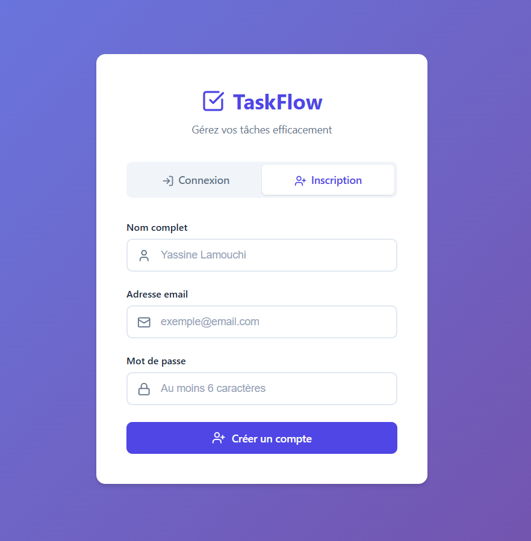
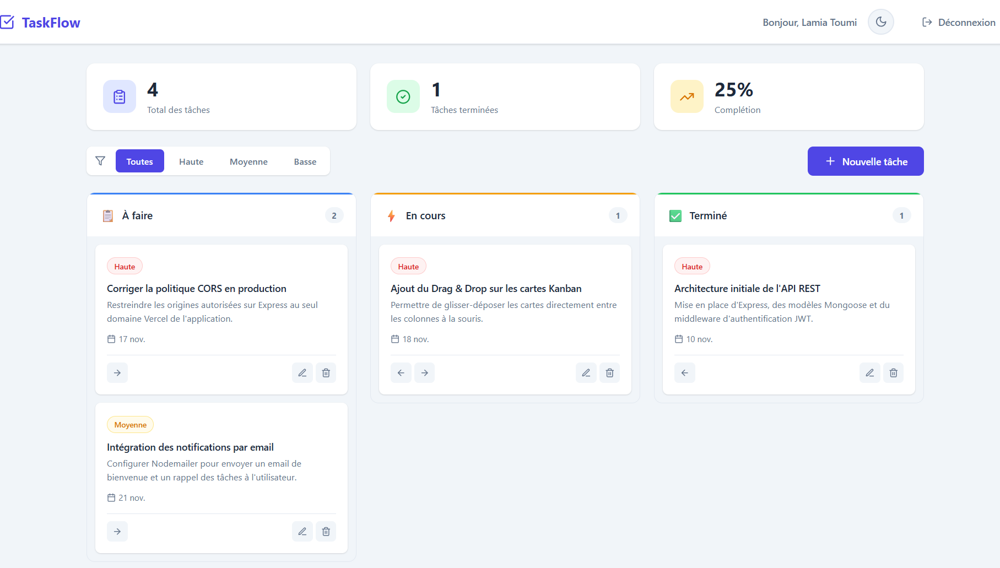
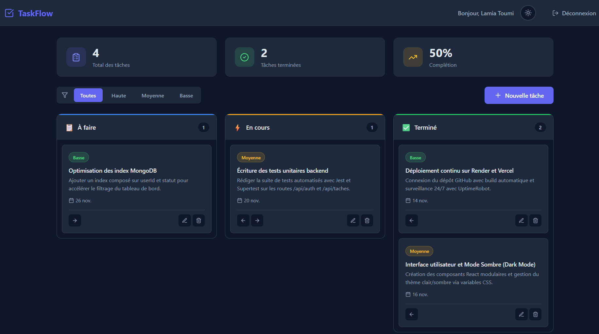
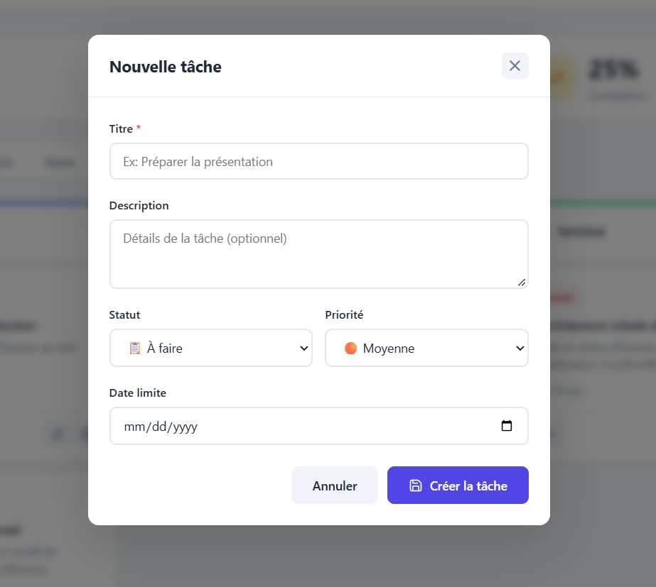
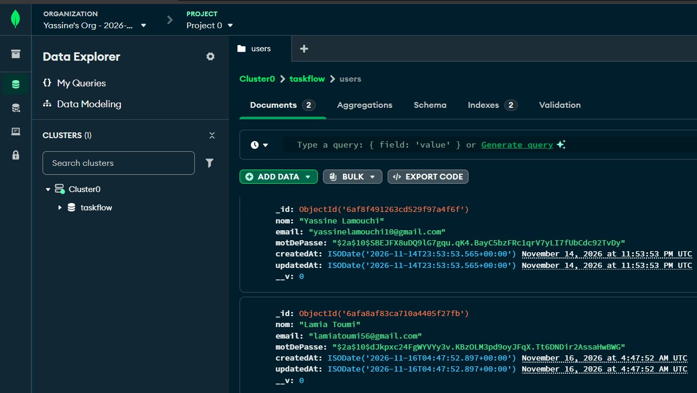

<div align="center">

# ✅ TaskFlow — Collaborative Task Manager

**A full-stack MERN Kanban board with JWT authentication, per-user data isolation, and Dark Mode.**


---

### 🌐 [Live Demo — taskflow-two-smoky.vercel.app](https://taskflow-two-smoky.vercel.app/)

</div>

---

## 📖 Project Overview

**TaskFlow** is a full-stack productivity application that lets users manage their tasks through an intuitive **Kanban board** interface. Each user registers with a secure account, creates tasks with priorities and deadlines, and tracks their progress across three status columns — all while their data remains **strictly isolated** from other users through JWT-based authentication and per-user database queries.

### Why the MERN Stack?

The **MERN** stack (MongoDB, Express.js, React, Node.js) was chosen specifically because it provides a unified development experience ideally suited for this type of application:

| Layer         | Technology           | Why It Fits                                                                                                                                                                                                                                                                          |
| ------------- | -------------------- | ------------------------------------------------------------------------------------------------------------------------------------------------------------------------------------------------------------------------------------------------------------------------------------ |
| **Database**  | MongoDB              | Tasks are naturally represented as flexible JSON documents with varying fields (optional descriptions, dates, priorities). MongoDB's document model maps directly to JavaScript objects — no ORM translation layer needed.                                                           |
| **Backend**   | Express.js + Node.js | A lightweight, non-blocking server handles concurrent API requests efficiently. Express provides clean RESTful routing, and sharing JavaScript across both server and client eliminates context-switching between languages.                                                         |
| **Frontend**  | React                | Component-based architecture is ideal for a Kanban board: each column, card, filter, and modal is a reusable, independently updating component. React's state management ensures that moving a task between columns or updating stats reflects instantly without a full page reload. |
| **Data Flow** | JSON end-to-end      | From MongoDB documents → Express API responses → React state, data flows as native JSON/JavaScript objects throughout the entire stack, with zero format conversion overhead.                                                                                                        |

---

## ✨ Key Features

- **🔐 Secure Authentication** — User registration and login with bcrypt password hashing and JWT token-based sessions (7-day expiry).
- **📋 Full Task CRUD** — Create, read, update, and delete tasks with title, description, priority, deadline, and status.
- **📊 Kanban Board** — Three visual columns: _À faire_ (To Do) → _En cours_ (In Progress) → _Terminé_ (Done), with one-click status transitions.
- **🎯 Priority Filtering** — Filter tasks by priority level (Haute / Moyenne / Basse) to focus on what matters.
- **📈 Live Completion Analytics** — Real-time dashboard stats: total tasks, completed count, and completion percentage.
- **🌙 Dark Mode** — Elegant slate-blue dark theme implemented with CSS variables and `localStorage` persistence — no page flash on reload.
- **🔒 Per-User Data Isolation** — Every database query is scoped to the authenticated user's `userId`, ensuring complete data privacy.

---

## 📸 Screenshots & Architecture Walkthrough

### Authentication Page



The login/registration interface uses a **tabbed single-page design** — users toggle between _Connexion_ and _Inscription_ without a page reload. Form validation runs both client-side (React controlled inputs) and server-side (Mongoose schema validators). On successful authentication, the JWT token is stored in `localStorage` and automatically attached to every subsequent API request via an Axios interceptor.

---

### Kanban Dashboard — Light Mode



The main dashboard presents three core sections: a **statistics bar** (total tasks, completed tasks, completion percentage), a **toolbar** with priority filters and the "New Task" button, and the **three-column Kanban board**. Each task card displays a color-coded priority badge (red / orange / green), the title, description, deadline with overdue detection, and quick-action buttons for moving, editing, or deleting the task.

---

### Kanban Dashboard — Dark Mode



The Dark Mode is implemented using a `data-theme="dark"` attribute on the root `<html>` element, which overrides CSS custom properties (`--bg`, `--surface`, `--text`, `--border`). The selected theme persists across sessions via `localStorage`. The color palette uses deep slate tones (`#0f172a`, `#1e293b`, `#334155`) that harmonize with the indigo accent color (`#6366f1`), avoiding harsh pure-black backgrounds.

---

### Task Creation / Editing Modal



A single `TaskModal` component handles both **creation** and **editing** workflows. When editing, form fields are pre-filled from the existing task data. The modal sends a `POST` or `PUT` request to the REST API depending on the mode, and the Kanban board refreshes automatically on success. The overlay closes on backdrop click or the cancel button.

---

### MongoDB Atlas — Data Structure



This view of MongoDB Atlas shows the actual database documents in production. Key observations: passwords are stored as **bcrypt hashes** (never plaintext), every task document contains a `userId` field referencing its owner, and Mongoose automatically manages `createdAt` / `updatedAt` timestamps. This structure enforces **per-user data isolation** — API routes always filter by the authenticated user's ID.

---

## 📁 Project Structure

```
TaskFlow/
│
├── backend/                    # Express.js REST API
│   ├── models/
│   │   ├── User.js             # User schema (bcrypt pre-save hook)
│   │   └── Task.js             # Task schema (status, priority, userId ref)
│   ├── middleware/
│   │   └── authMiddleware.js   # JWT verification middleware
│   ├── routes/
│   │   ├── authRoutes.js       # POST /inscription, /connexion, GET /profil
│   │   └── taskRoutes.js       # CRUD + GET /stats (filtered by userId)
│   ├── server.js               # Express app, CORS, MongoDB connection
│   ├── .env.example            # Environment variables template
│   └── package.json
│
├── frontend/                   # React single-page application
│   ├── public/
│   │   └── index.html
│   ├── src/
│   │   ├── components/
│   │   │   ├── ProtectedRoute.jsx   # Auth guard for private routes
│   │   │   └── TaskModal.jsx        # Create/Edit task form modal
│   │   ├── pages/
│   │   │   ├── AuthPage.jsx         # Login / Register with tab toggle
│   │   │   └── Dashboard.jsx        # Navbar, stats, filters, Kanban board
│   │   ├── api.js              # Axios instance with JWT interceptor
│   │   ├── App.js              # React Router v6 + theme management
│   │   ├── App.css             # Dashboard, Kanban & Dark Mode styles
│   │   └── index.css           # Global variables & Auth page styles
│   ├── vercel.json             # SPA rewrite rules for Vercel
│   └── package.json
│
├── screenshots/                # App screenshots for documentation
└── README.md
```

---

## 🛠️ Local Installation & Setup

### Prerequisites

- [Node.js](https://nodejs.org/) (v18+ recommended)
- A free [MongoDB Atlas](https://www.mongodb.com/atlas) cluster
- Git

### 1. Clone the repository

```bash
git clone https://github.com/Yassine-Lamouchi/TaskFlow.git
cd TaskFlow
```

### 2. Configure the backend environment

```bash
cp backend/.env.example backend/.env
```

Open `backend/.env` and fill in your values:

```env
PORT=5000
MONGO_URI=mongodb+srv://<user>:<password>@<cluster>.mongodb.net/taskflow?retryWrites=true&w=majority
JWT_SECRET=your_secret_key_here
```

### 3. Install dependencies

```bash
# Backend dependencies
cd backend
npm install

# Frontend dependencies
cd ../frontend
npm install
```

### 4. Run both servers

Open **two terminals** from the project root:

```bash
# Terminal 1 — Backend (http://localhost:5000)
cd backend
npm run dev

# Terminal 2 — Frontend (http://localhost:3000)
cd frontend
npm start
```

The React app opens automatically at `http://localhost:3000`.

---

## 🧩 Technical Challenges & Future Improvements

### Challenges Solved

| Challenge                           | Solution                                                                                                                                                                                                                                |
| ----------------------------------- | --------------------------------------------------------------------------------------------------------------------------------------------------------------------------------------------------------------------------------------- |
| **Stateless route protection**      | JWT tokens are verified on every API call via Express middleware — no server-side session storage needed. The frontend guards routes with a `ProtectedRoute` component that checks `localStorage` for a valid token.                    |
| **Per-user data isolation**         | Every task query in `taskRoutes.js` includes a `{ userId: req.user._id }` filter, ensuring users can never access, modify, or delete another user's data — even with a forged request.                                                  |
| **Environment-aware API URL**       | The frontend uses `process.env.REACT_APP_API_URL` with a fallback to `localhost:5000`, allowing the same codebase to work seamlessly in local development (no env variable) and production (Vercel injects the variable at build time). |
| **Theme persistence without flash** | Dark Mode state is saved in `localStorage` and applied via `document.documentElement.setAttribute("data-theme", theme)` on mount, preventing a white flash before the CSS variables take effect.                                        |

### Future Improvements

- **🖱️ Drag & Drop** — Implement drag-and-drop card movement between Kanban columns using a library like `react-beautiful-dnd`.
- **👥 Collaborative Shared Boards** — Allow users to create shared workspaces and assign tasks to team members in real time.
- **🔔 Email Notifications** — Send deadline reminders and weekly progress summaries via Nodemailer.
- **📱 Progressive Web App** — Add PWA support for offline access and mobile installation.
